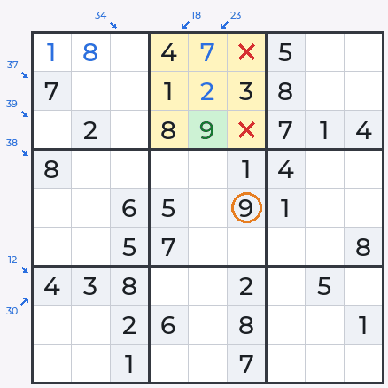

<!-- Written by tools/walkthrough.py little-killer: edit the script, not this page. -->
# Little Killer, step 5: the 9 in box 2

**Step 5 of 49** · [← Step 4](step-04.md) · [All steps](../little-killer.md#the-whole-puzzle-step-by-step) · [Step 6 →](step-06.md)

Box 2 needs a 9. r1c6 and r3c6: column 6 has one (r5c6). Only **r3c5** is left: **r3c5 = 9**.

**Step 5 of 49** · [← Step 4](step-04.md) · [All steps](../little-killer.md#the-whole-puzzle-step-by-step) · [Step 6 →](step-06.md)
