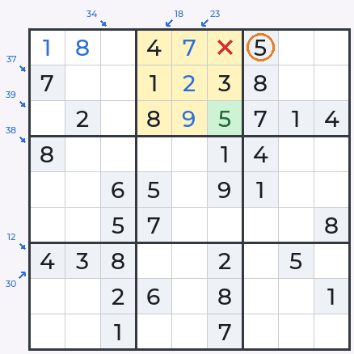

<!-- Written by tools/walkthrough.py little-killer: edit the script, not this page. -->
# Little Killer, step 6: the 5 in box 2

**Step 6 of 49** · [← Step 5](step-05.md) · [All steps](../little-killer.md#the-whole-puzzle-step-by-step) · [Step 7 →](step-07.md)

Box 2 needs a 5. r1c6: row 1 has one (r1c7). Only **r3c6** is left: **r3c6 = 5**.

**Step 6 of 49** · [← Step 5](step-05.md) · [All steps](../little-killer.md#the-whole-puzzle-step-by-step) · [Step 7 →](step-07.md)
