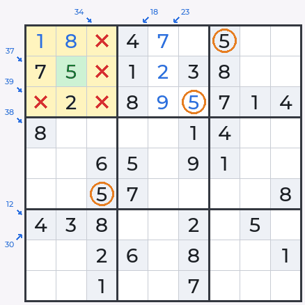

<!-- Written by tools/walkthrough.py little-killer: edit the script, not this page. -->
# Little Killer, step 7: the 5 in box 1

**Step 7 of 49** · [← Step 6](step-06.md) · [All steps](../little-killer.md#the-whole-puzzle-step-by-step) · [Step 8 →](step-08.md)

Box 1 needs a 5. r1c3: row 1 has one (r1c7). r2c3: column 3 has one (r6c3). r3c1 and r3c3: row 3 has one (r3c6). Only **r2c2** is left: **r2c2 = 5**.

**Step 7 of 49** · [← Step 6](step-06.md) · [All steps](../little-killer.md#the-whole-puzzle-step-by-step) · [Step 8 →](step-08.md)
