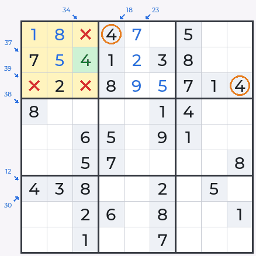

<!-- Written by tools/walkthrough.py little-killer: edit the script, not this page. -->
# Little Killer, step 8: the 4 in box 1

**Step 8 of 49** · [← Step 7](step-07.md) · [All steps](../little-killer.md#the-whole-puzzle-step-by-step) · [Step 9 →](step-09.md)

Box 1 needs a 4. r1c3: row 1 has one (r1c4). r3c1 and r3c3: row 3 has one (r3c9). Only **r2c3** is left: **r2c3 = 4**.

**Step 8 of 49** · [← Step 7](step-07.md) · [All steps](../little-killer.md#the-whole-puzzle-step-by-step) · [Step 9 →](step-09.md)
