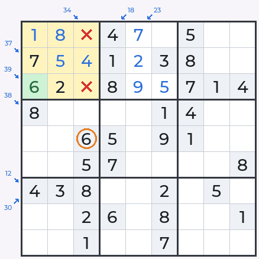

<!-- Written by tools/walkthrough.py little-killer: edit the script, not this page. -->
# Little Killer, step 9: the 6 in box 1

**Step 9 of 49** · [← Step 8](step-08.md) · [All steps](../little-killer.md#the-whole-puzzle-step-by-step) · [Step 10 →](step-10.md)

Box 1 needs a 6. r1c3 and r3c3: column 3 has one (r5c3). Only **r3c1** is left: **r3c1 = 6**.

**Step 9 of 49** · [← Step 8](step-08.md) · [All steps](../little-killer.md#the-whole-puzzle-step-by-step) · [Step 10 →](step-10.md)
