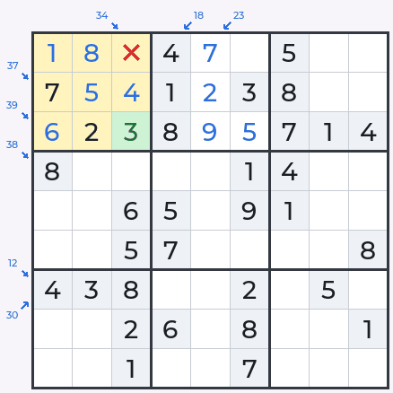

<!-- Written by tools/walkthrough.py little-killer: edit the script, not this page. -->
# Little Killer, step 10: the 3 in box 1

**Step 10 of 49** · [← Step 9](step-09.md) · [All steps](../little-killer.md#the-whole-puzzle-step-by-step) · [Step 11 →](step-11.md)

Box 1 needs a 3. r1c3: on its diagonal of 34 (with 1, 9, 1 and 1 already on it), a 3 would leave 19 for its other 2 cells, too much. Only **r3c3** is left: **r3c3 = 3**.

**Step 10 of 49** · [← Step 9](step-09.md) · [All steps](../little-killer.md#the-whole-puzzle-step-by-step) · [Step 11 →](step-11.md)
