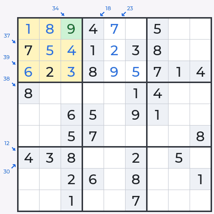

<!-- Written by tools/walkthrough.py little-killer: edit the script, not this page. -->
# Little Killer, step 11: the 9 in box 1

**Step 11 of 49** · [← Step 10](step-10.md) · [All steps](../little-killer.md#the-whole-puzzle-step-by-step) · [Step 12 →](step-12.md)

Box 1 needs a 9, and r1c3 is its last empty cell: **r1c3 = 9**.

**Step 11 of 49** · [← Step 10](step-10.md) · [All steps](../little-killer.md#the-whole-puzzle-step-by-step) · [Step 12 →](step-12.md)
