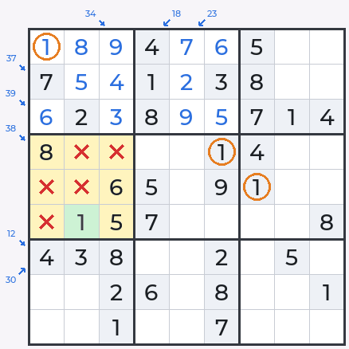

<!-- Written by tools/walkthrough.py little-killer: edit the script, not this page. -->
# Little Killer, step 13: the 1 in box 4

**Step 13 of 49** · [← Step 12](step-12.md) · [All steps](../little-killer.md#the-whole-puzzle-step-by-step) · [Step 14 →](step-14.md)

Box 4 needs a 1. r4c2 and r4c3: row 4 has one (r4c6). r5c1 and r5c2: row 5 has one (r5c7). r6c1: column 1 has one (r1c1). Only **r6c2** is left: **r6c2 = 1**.

**Step 13 of 49** · [← Step 12](step-12.md) · [All steps](../little-killer.md#the-whole-puzzle-step-by-step) · [Step 14 →](step-14.md)
