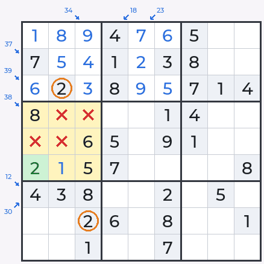

<!-- Written by tools/walkthrough.py little-killer: edit the script, not this page. -->
# Little Killer, step 14: the 2 in box 4

**Step 14 of 49** · [← Step 13](step-13.md) · [All steps](../little-killer.md#the-whole-puzzle-step-by-step) · [Step 15 →](step-15.md)

Box 4 needs a 2. r4c2 and r5c2: column 2 has one (r3c2). r4c3: column 3 has one (r8c3). r5c1: on its diagonal of 23 (with 7, 1 and 3 already on it), a 2 would leave 10 for its other cell, too much. Only **r6c1** is left: **r6c1 = 2**.

**Step 14 of 49** · [← Step 13](step-13.md) · [All steps](../little-killer.md#the-whole-puzzle-step-by-step) · [Step 15 →](step-15.md)
