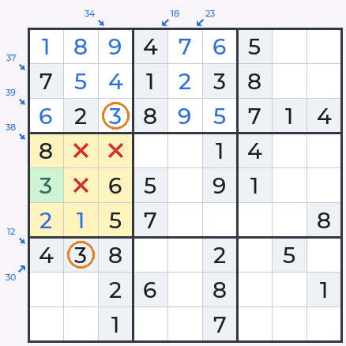

<!-- Written by tools/walkthrough.py little-killer: edit the script, not this page. -->
# Little Killer, step 15: the 3 in box 4

**Step 15 of 49** · [← Step 14](step-14.md) · [All steps](../little-killer.md#the-whole-puzzle-step-by-step) · [Step 16 →](step-16.md)

Box 4 needs a 3. r4c2 and r5c2: column 2 has one (r7c2). r4c3: column 3 has one (r3c3). Only **r5c1** is left: **r5c1 = 3**.

**Step 15 of 49** · [← Step 14](step-14.md) · [All steps](../little-killer.md#the-whole-puzzle-step-by-step) · [Step 16 →](step-16.md)
