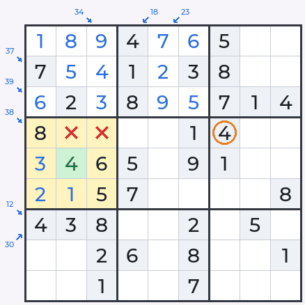

<!-- Written by tools/walkthrough.py little-killer: edit the script, not this page. -->
# Little Killer, step 16: the 4 in box 4

**Step 16 of 49** · [← Step 15](step-15.md) · [All steps](../little-killer.md#the-whole-puzzle-step-by-step) · [Step 17 →](step-17.md)

Box 4 needs a 4. r4c2 and r4c3: row 4 has one (r4c7). Only **r5c2** is left: **r5c2 = 4**.

**Step 16 of 49** · [← Step 15](step-15.md) · [All steps](../little-killer.md#the-whole-puzzle-step-by-step) · [Step 17 →](step-17.md)
