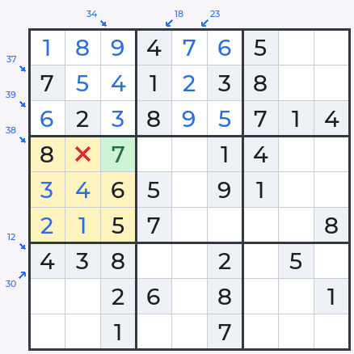

<!-- Written by tools/walkthrough.py little-killer: edit the script, not this page. -->
# Little Killer, step 17: the 7 in box 4

**Step 17 of 49** · [← Step 16](step-16.md) · [All steps](../little-killer.md#the-whole-puzzle-step-by-step) · [Step 18 →](step-18.md)

Box 4 needs a 7. r4c2: its diagonal of 23 (with 7, 1, 3 and 3 already on it) needs 9 there. Only **r4c3** is left: **r4c3 = 7**.

**Step 17 of 49** · [← Step 16](step-16.md) · [All steps](../little-killer.md#the-whole-puzzle-step-by-step) · [Step 18 →](step-18.md)
