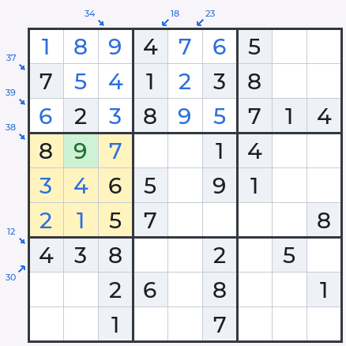

<!-- Written by tools/walkthrough.py little-killer: edit the script, not this page. -->
# Little Killer, step 18: the 9 in box 4

**Step 18 of 49** · [← Step 17](step-17.md) · [All steps](../little-killer.md#the-whole-puzzle-step-by-step) · [Step 19 →](step-19.md)

Box 4 needs a 9, and r4c2 is its last empty cell: **r4c2 = 9**.

**Step 18 of 49** · [← Step 17](step-17.md) · [All steps](../little-killer.md#the-whole-puzzle-step-by-step) · [Step 19 →](step-19.md)
