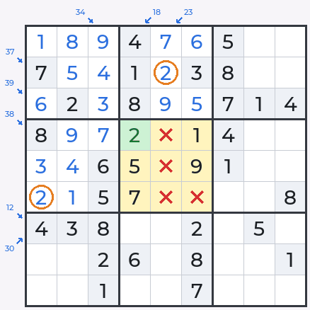

<!-- Written by tools/walkthrough.py little-killer: edit the script, not this page. -->
# Little Killer, step 19: the 2 in box 5

**Step 19 of 49** · [← Step 18](step-18.md) · [All steps](../little-killer.md#the-whole-puzzle-step-by-step) · [Step 20 →](step-20.md)

Box 5 needs a 2. r4c5 and r5c5: column 5 has one (r2c5). r6c5 and r6c6: row 6 has one (r6c1). Only **r4c4** is left: **r4c4 = 2**.

**Step 19 of 49** · [← Step 18](step-18.md) · [All steps](../little-killer.md#the-whole-puzzle-step-by-step) · [Step 20 →](step-20.md)
