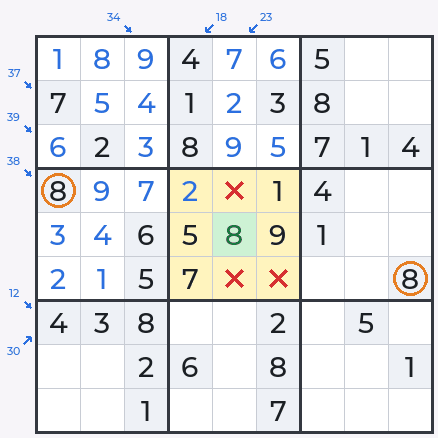

<!-- Written by tools/walkthrough.py little-killer: edit the script, not this page. -->
# Little Killer, step 20: the 8 in box 5

**Step 20 of 49** · [← Step 19](step-19.md) · [All steps](../little-killer.md#the-whole-puzzle-step-by-step) · [Step 21 →](step-21.md)

Box 5 needs an 8. r4c5: row 4 has one (r4c1). r6c5 and r6c6: row 6 has one (r6c9). Only **r5c5** is left: **r5c5 = 8**.

**Step 20 of 49** · [← Step 19](step-19.md) · [All steps](../little-killer.md#the-whole-puzzle-step-by-step) · [Step 21 →](step-21.md)
