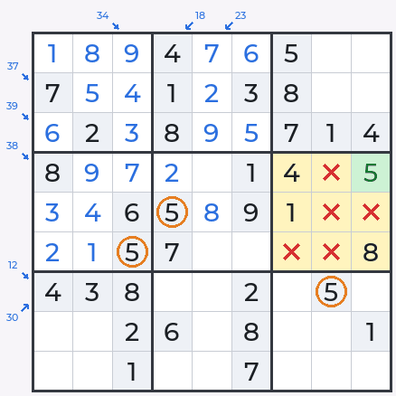

<!-- Written by tools/walkthrough.py little-killer: edit the script, not this page. -->
# Little Killer, step 21: the 5 in box 6

**Step 21 of 49** · [← Step 20](step-20.md) · [All steps](../little-killer.md#the-whole-puzzle-step-by-step) · [Step 22 →](step-22.md)

Box 6 needs a 5. r4c8: column 8 has one (r7c8). r5c8 and r5c9: row 5 has one (r5c4). r6c7 and r6c8: row 6 has one (r6c3). Only **r4c9** is left: **r4c9 = 5**.

**Step 21 of 49** · [← Step 20](step-20.md) · [All steps](../little-killer.md#the-whole-puzzle-step-by-step) · [Step 22 →](step-22.md)
