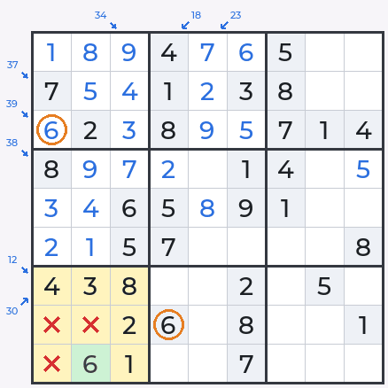

<!-- Written by tools/walkthrough.py little-killer: edit the script, not this page. -->
# Little Killer, step 22: the 6 in box 7

**Step 22 of 49** · [← Step 21](step-21.md) · [All steps](../little-killer.md#the-whole-puzzle-step-by-step) · [Step 23 →](step-23.md)

Box 7 needs a 6. r8c1 and r8c2: row 8 has one (r8c4). r9c1: column 1 has one (r3c1). Only **r9c2** is left: **r9c2 = 6**.

**Step 22 of 49** · [← Step 21](step-21.md) · [All steps](../little-killer.md#the-whole-puzzle-step-by-step) · [Step 23 →](step-23.md)
