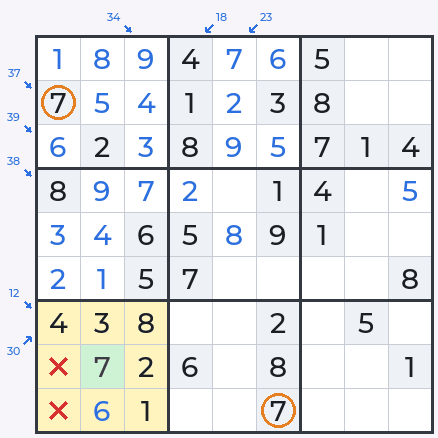

<!-- Written by tools/walkthrough.py little-killer: edit the script, not this page. -->
# Little Killer, step 23: the 7 in box 7

**Step 23 of 49** · [← Step 22](step-22.md) · [All steps](../little-killer.md#the-whole-puzzle-step-by-step) · [Step 24 →](step-24.md)

Box 7 needs a 7. r8c1: column 1 has one (r2c1). r9c1: row 9 has one (r9c6). Only **r8c2** is left: **r8c2 = 7**.

**Step 23 of 49** · [← Step 22](step-22.md) · [All steps](../little-killer.md#the-whole-puzzle-step-by-step) · [Step 24 →](step-24.md)
