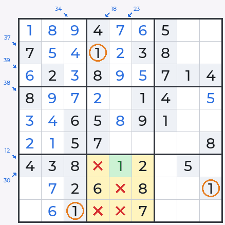

<!-- Written by tools/walkthrough.py little-killer: edit the script, not this page. -->
# Little Killer, step 24: the 1 in box 8

**Step 24 of 49** · [← Step 23](step-23.md) · [All steps](../little-killer.md#the-whole-puzzle-step-by-step) · [Step 25 →](step-25.md)

Box 8 needs a 1. r7c4: column 4 has one (r2c4). r8c5: row 8 has one (r8c9). r9c4 and r9c5: row 9 has one (r9c3). Only **r7c5** is left: **r7c5 = 1**.

**Step 24 of 49** · [← Step 23](step-23.md) · [All steps](../little-killer.md#the-whole-puzzle-step-by-step) · [Step 25 →](step-25.md)
