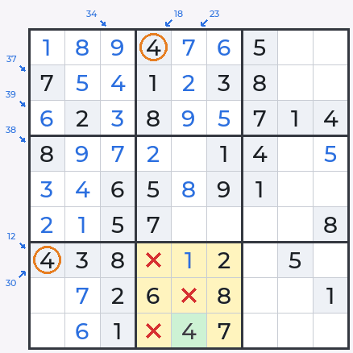

<!-- Written by tools/walkthrough.py little-killer: edit the script, not this page. -->
# Little Killer, step 25: the 4 in box 8

**Step 25 of 49** · [← Step 24](step-24.md) · [All steps](../little-killer.md#the-whole-puzzle-step-by-step) · [Step 26 →](step-26.md)

Box 8 needs a 4. r7c4: row 7 has one (r7c1). r9c4: column 4 has one (r1c4). r8c5: on its diagonal of 38 (with 8, 4, 5 and 7 already on it), a 4 would leave 10 for its other cell, too much. Only **r9c5** is left: **r9c5 = 4**.

**Step 25 of 49** · [← Step 24](step-24.md) · [All steps](../little-killer.md#the-whole-puzzle-step-by-step) · [Step 26 →](step-26.md)
