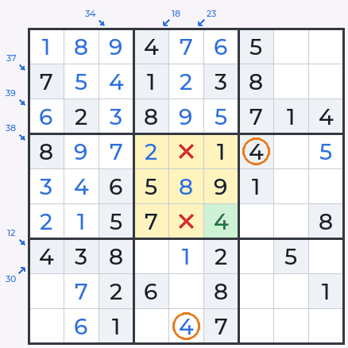

<!-- Written by tools/walkthrough.py little-killer: edit the script, not this page. -->
# Little Killer, step 26: the 4 in box 5

**Step 26 of 49** · [← Step 25](step-25.md) · [All steps](../little-killer.md#the-whole-puzzle-step-by-step) · [Step 27 →](step-27.md)

Box 5 needs a 4. r4c5: row 4 has one (r4c7). r6c5: column 5 has one (r9c5). Only **r6c6** is left: **r6c6 = 4**.

**Step 26 of 49** · [← Step 25](step-25.md) · [All steps](../little-killer.md#the-whole-puzzle-step-by-step) · [Step 27 →](step-27.md)
