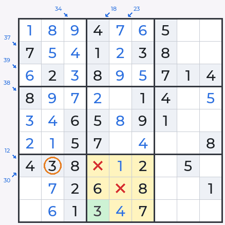

<!-- Written by tools/walkthrough.py little-killer: edit the script, not this page. -->
# Little Killer, step 27: the 3 in box 8

**Step 27 of 49** · [← Step 26](step-26.md) · [All steps](../little-killer.md#the-whole-puzzle-step-by-step) · [Step 28 →](step-28.md)

Box 8 needs a 3. r7c4: row 7 has one (r7c2). r8c5: on its diagonal of 38 (with 8, 4, 5 and 7 already on it), a 3 would leave 11 for its other cell, too much. Only **r9c4** is left: **r9c4 = 3**.

**Step 27 of 49** · [← Step 26](step-26.md) · [All steps](../little-killer.md#the-whole-puzzle-step-by-step) · [Step 28 →](step-28.md)
