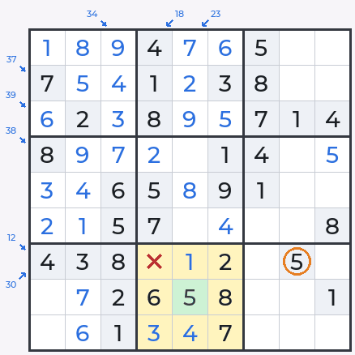

<!-- Written by tools/walkthrough.py little-killer: edit the script, not this page. -->
# Little Killer, step 28: the 5 in box 8

**Step 28 of 49** · [← Step 27](step-27.md) · [All steps](../little-killer.md#the-whole-puzzle-step-by-step) · [Step 29 →](step-29.md)

Box 8 needs a 5. r7c4: row 7 has one (r7c8). Only **r8c5** is left: **r8c5 = 5**.

**Step 28 of 49** · [← Step 27](step-27.md) · [All steps](../little-killer.md#the-whole-puzzle-step-by-step) · [Step 29 →](step-29.md)
