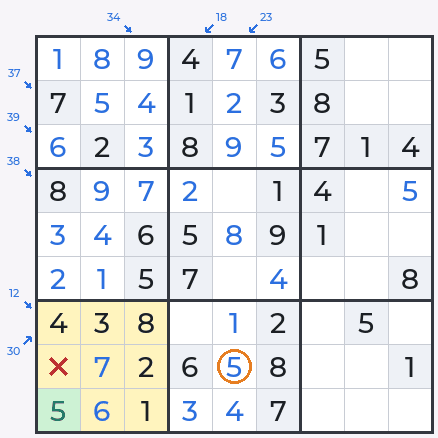

<!-- Written by tools/walkthrough.py little-killer: edit the script, not this page. -->
# Little Killer, step 29: the 5 in box 7

**Step 29 of 49** · [← Step 28](step-28.md) · [All steps](../little-killer.md#the-whole-puzzle-step-by-step) · [Step 30 →](step-30.md)

Box 7 needs a 5. r8c1: row 8 has one (r8c5). Only **r9c1** is left: **r9c1 = 5**.

**Step 29 of 49** · [← Step 28](step-28.md) · [All steps](../little-killer.md#the-whole-puzzle-step-by-step) · [Step 30 →](step-30.md)
