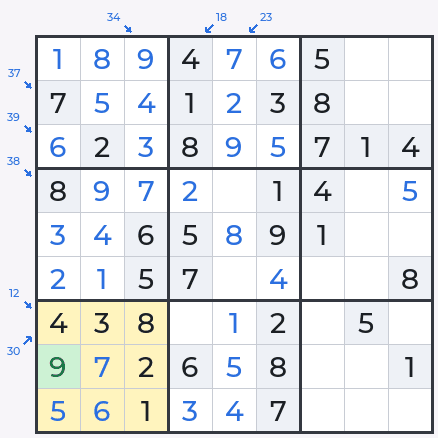

<!-- Written by tools/walkthrough.py little-killer: edit the script, not this page. -->
# Little Killer, step 30: the 9 in box 7

**Step 30 of 49** · [← Step 29](step-29.md) · [All steps](../little-killer.md#the-whole-puzzle-step-by-step) · [Step 31 →](step-31.md)

Box 7 needs a 9, and r8c1 is its last empty cell: **r8c1 = 9**.

**Step 30 of 49** · [← Step 29](step-29.md) · [All steps](../little-killer.md#the-whole-puzzle-step-by-step) · [Step 31 →](step-31.md)
