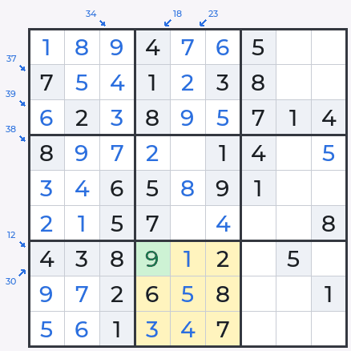

<!-- Written by tools/walkthrough.py little-killer: edit the script, not this page. -->
# Little Killer, step 31: the 9 in box 8

**Step 31 of 49** · [← Step 30](step-30.md) · [All steps](../little-killer.md#the-whole-puzzle-step-by-step) · [Step 32 →](step-32.md)

Box 8 needs a 9, and r7c4 is its last empty cell: **r7c4 = 9**.

**Step 31 of 49** · [← Step 30](step-30.md) · [All steps](../little-killer.md#the-whole-puzzle-step-by-step) · [Step 32 →](step-32.md)
