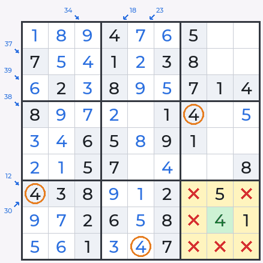

<!-- Written by tools/walkthrough.py little-killer: edit the script, not this page. -->
# Little Killer, step 32: the 4 in box 9

**Step 32 of 49** · [← Step 31](step-31.md) · [All steps](../little-killer.md#the-whole-puzzle-step-by-step) · [Step 33 →](step-33.md)

Box 9 needs a 4. r7c7 and r7c9: row 7 has one (r7c1). r8c7: column 7 has one (r4c7). r9c7, r9c8 and r9c9: row 9 has one (r9c5). Only **r8c8** is left: **r8c8 = 4**.

**Step 32 of 49** · [← Step 31](step-31.md) · [All steps](../little-killer.md#the-whole-puzzle-step-by-step) · [Step 33 →](step-33.md)
