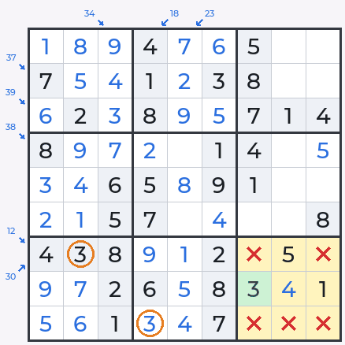

<!-- Written by tools/walkthrough.py little-killer: edit the script, not this page. -->
# Little Killer, step 33: the 3 in box 9

**Step 33 of 49** · [← Step 32](step-32.md) · [All steps](../little-killer.md#the-whole-puzzle-step-by-step) · [Step 34 →](step-34.md)

Box 9 needs a 3. r7c7 and r7c9: row 7 has one (r7c2). r9c7, r9c8 and r9c9: row 9 has one (r9c4). Only **r8c7** is left: **r8c7 = 3**.

**Step 33 of 49** · [← Step 32](step-32.md) · [All steps](../little-killer.md#the-whole-puzzle-step-by-step) · [Step 34 →](step-34.md)
