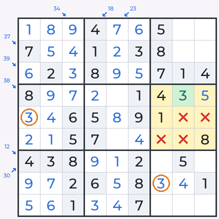

<!-- Written by tools/walkthrough.py little-killer: edit the script, not this page. -->
# Little Killer, step 34: the 3 in box 6

**Step 34 of 49** · [← Step 33](step-33.md) · [All steps](../little-killer.md#the-whole-puzzle-step-by-step) · [Step 35 →](step-35.md)

Box 6 needs a 3. r5c8 and r5c9: row 5 has one (r5c1). r6c7: column 7 has one (r8c7). r6c8: on its diagonal of 34 (with 9, 1, 9, 1 and 1 already on it), a 3 would leave 10 for its other cell, too much. Only **r4c8** is left: **r4c8 = 3**.

**Step 34 of 49** · [← Step 33](step-33.md) · [All steps](../little-killer.md#the-whole-puzzle-step-by-step) · [Step 35 →](step-35.md)
