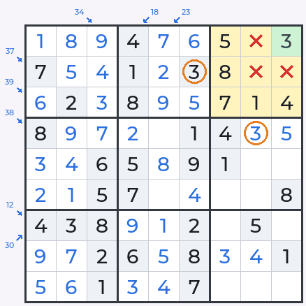

<!-- Written by tools/walkthrough.py little-killer: edit the script, not this page. -->
# Little Killer, step 35: the 3 in box 3

**Step 35 of 49** · [← Step 34](step-34.md) · [All steps](../little-killer.md#the-whole-puzzle-step-by-step) · [Step 36 →](step-36.md)

Box 3 needs a 3. r1c8: column 8 has one (r4c8). r2c8 and r2c9: row 2 has one (r2c6). Only **r1c9** is left: **r1c9 = 3**.

**Step 35 of 49** · [← Step 34](step-34.md) · [All steps](../little-killer.md#the-whole-puzzle-step-by-step) · [Step 36 →](step-36.md)
