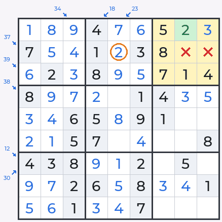

<!-- Written by tools/walkthrough.py little-killer: edit the script, not this page. -->
# Little Killer, step 36: the 2 in box 3

**Step 36 of 49** · [← Step 35](step-35.md) · [All steps](../little-killer.md#the-whole-puzzle-step-by-step) · [Step 37 →](step-37.md)

Box 3 needs a 2. r2c8 and r2c9: row 2 has one (r2c5). Only **r1c8** is left: **r1c8 = 2**.

**Step 36 of 49** · [← Step 35](step-35.md) · [All steps](../little-killer.md#the-whole-puzzle-step-by-step) · [Step 37 →](step-37.md)
