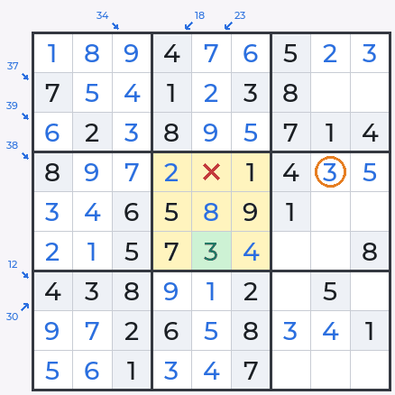

<!-- Written by tools/walkthrough.py little-killer: edit the script, not this page. -->
# Little Killer, step 37: the 3 in box 5

**Step 37 of 49** · [← Step 36](step-36.md) · [All steps](../little-killer.md#the-whole-puzzle-step-by-step) · [Step 38 →](step-38.md)

Box 5 needs a 3. r4c5: row 4 has one (r4c8). Only **r6c5** is left: **r6c5 = 3**.

**Step 37 of 49** · [← Step 36](step-36.md) · [All steps](../little-killer.md#the-whole-puzzle-step-by-step) · [Step 38 →](step-38.md)
