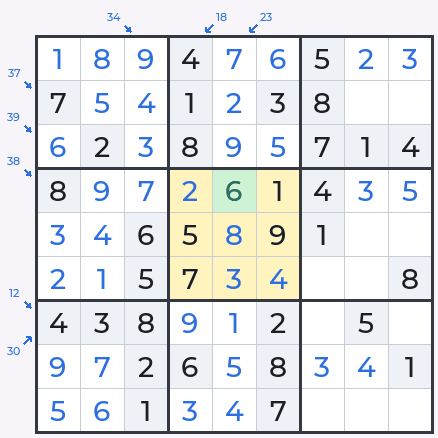

<!-- Written by tools/walkthrough.py little-killer: edit the script, not this page. -->
# Little Killer, step 38: the 6 in box 5

**Step 38 of 49** · [← Step 37](step-37.md) · [All steps](../little-killer.md#the-whole-puzzle-step-by-step) · [Step 39 →](step-39.md)

Box 5 needs a 6, and r4c5 is its last empty cell: **r4c5 = 6**.

**Step 38 of 49** · [← Step 37](step-37.md) · [All steps](../little-killer.md#the-whole-puzzle-step-by-step) · [Step 39 →](step-39.md)
