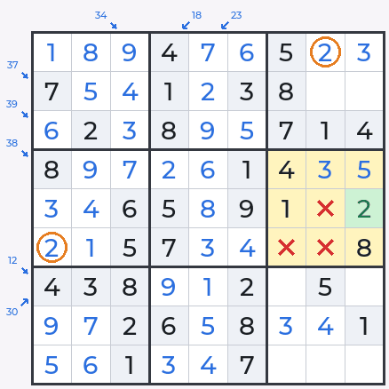

<!-- Written by tools/walkthrough.py little-killer: edit the script, not this page. -->
# Little Killer, step 39: the 2 in box 6

**Step 39 of 49** · [← Step 38](step-38.md) · [All steps](../little-killer.md#the-whole-puzzle-step-by-step) · [Step 40 →](step-40.md)

Box 6 needs a 2. r5c8: column 8 has one (r1c8). r6c7 and r6c8: row 6 has one (r6c1). Only **r5c9** is left: **r5c9 = 2**.

**Step 39 of 49** · [← Step 38](step-38.md) · [All steps](../little-killer.md#the-whole-puzzle-step-by-step) · [Step 40 →](step-40.md)
