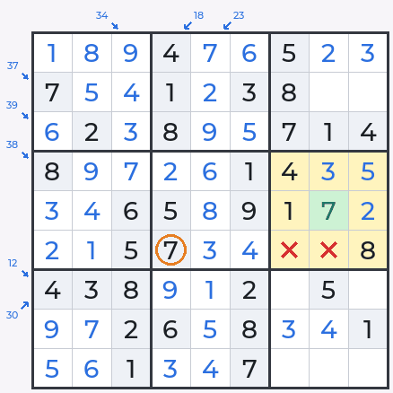

<!-- Written by tools/walkthrough.py little-killer: edit the script, not this page. -->
# Little Killer, step 40: the 7 in box 6

**Step 40 of 49** · [← Step 39](step-39.md) · [All steps](../little-killer.md#the-whole-puzzle-step-by-step) · [Step 41 →](step-41.md)

Box 6 needs a 7. r6c7 and r6c8: row 6 has one (r6c4). Only **r5c8** is left: **r5c8 = 7**.

**Step 40 of 49** · [← Step 39](step-39.md) · [All steps](../little-killer.md#the-whole-puzzle-step-by-step) · [Step 41 →](step-41.md)
