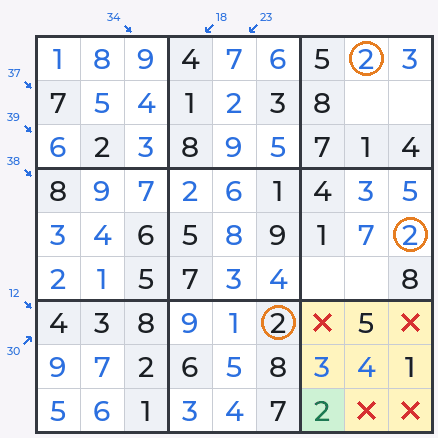

<!-- Written by tools/walkthrough.py little-killer: edit the script, not this page. -->
# Little Killer, step 41: the 2 in box 9

**Step 41 of 49** · [← Step 40](step-40.md) · [All steps](../little-killer.md#the-whole-puzzle-step-by-step) · [Step 42 →](step-42.md)

Box 9 needs a 2. r7c7 and r7c9: row 7 has one (r7c6). r9c8: column 8 has one (r1c8). r9c9: column 9 has one (r5c9). Only **r9c7** is left: **r9c7 = 2**.

**Step 41 of 49** · [← Step 40](step-40.md) · [All steps](../little-killer.md#the-whole-puzzle-step-by-step) · [Step 42 →](step-42.md)
