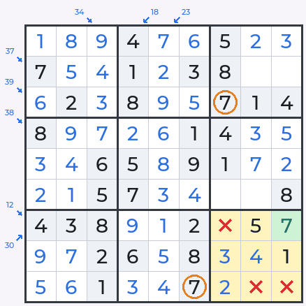

<!-- Written by tools/walkthrough.py little-killer: edit the script, not this page. -->
# Little Killer, step 42: the 7 in box 9

**Step 42 of 49** · [← Step 41](step-41.md) · [All steps](../little-killer.md#the-whole-puzzle-step-by-step) · [Step 43 →](step-43.md)

Box 9 needs a 7. r7c7: column 7 has one (r3c7). r9c8 and r9c9: row 9 has one (r9c6). Only **r7c9** is left: **r7c9 = 7**.

**Step 42 of 49** · [← Step 41](step-41.md) · [All steps](../little-killer.md#the-whole-puzzle-step-by-step) · [Step 43 →](step-43.md)
