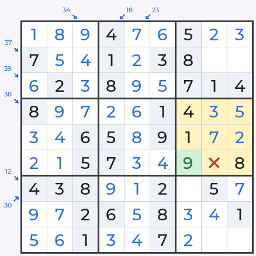

<!-- Written by tools/walkthrough.py little-killer: edit the script, not this page. -->
# Little Killer, step 43: the 9 in box 6

**Step 43 of 49** · [← Step 42](step-42.md) · [All steps](../little-killer.md#the-whole-puzzle-step-by-step) · [Step 44 →](step-44.md)

Box 6 needs a 9. r6c8: its diagonal of 34 (with 9, 1, 9, 1, 1 and 7 already on it) needs 6 there. Only **r6c7** is left: **r6c7 = 9**.

**Step 43 of 49** · [← Step 42](step-42.md) · [All steps](../little-killer.md#the-whole-puzzle-step-by-step) · [Step 44 →](step-44.md)
