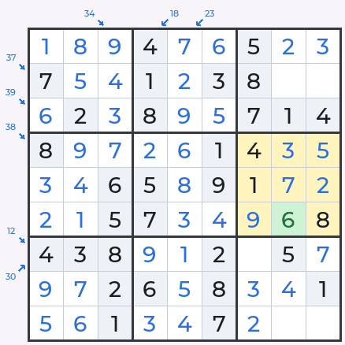

<!-- Written by tools/walkthrough.py little-killer: edit the script, not this page. -->
# Little Killer, step 44: the 6 in box 6

**Step 44 of 49** · [← Step 43](step-43.md) · [All steps](../little-killer.md#the-whole-puzzle-step-by-step) · [Step 45 →](step-45.md)

Box 6 needs a 6, and r6c8 is its last empty cell: **r6c8 = 6**.

**Step 44 of 49** · [← Step 43](step-43.md) · [All steps](../little-killer.md#the-whole-puzzle-step-by-step) · [Step 45 →](step-45.md)
