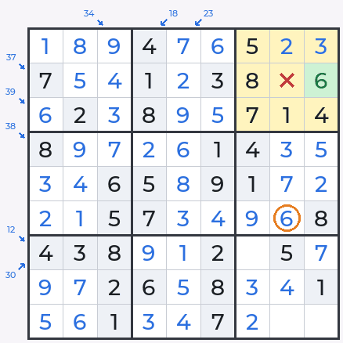

<!-- Written by tools/walkthrough.py little-killer: edit the script, not this page. -->
# Little Killer, step 45: the 6 in box 3

**Step 45 of 49** · [← Step 44](step-44.md) · [All steps](../little-killer.md#the-whole-puzzle-step-by-step) · [Step 46 →](step-46.md)

Box 3 needs a 6. r2c8: column 8 has one (r6c8). Only **r2c9** is left: **r2c9 = 6**.

**Step 45 of 49** · [← Step 44](step-44.md) · [All steps](../little-killer.md#the-whole-puzzle-step-by-step) · [Step 46 →](step-46.md)
