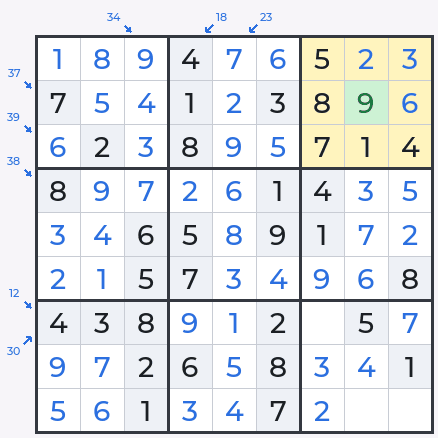

<!-- Written by tools/walkthrough.py little-killer: edit the script, not this page. -->
# Little Killer, step 46: the 9 in box 3

**Step 46 of 49** · [← Step 45](step-45.md) · [All steps](../little-killer.md#the-whole-puzzle-step-by-step) · [Step 47 →](step-47.md)

Box 3 needs a 9, and r2c8 is its last empty cell: **r2c8 = 9**.

**Step 46 of 49** · [← Step 45](step-45.md) · [All steps](../little-killer.md#the-whole-puzzle-step-by-step) · [Step 47 →](step-47.md)
