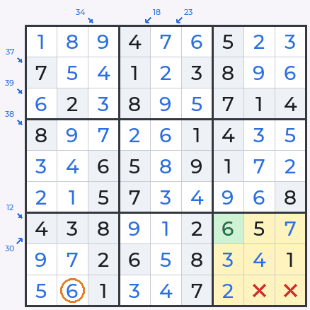

<!-- Written by tools/walkthrough.py little-killer: edit the script, not this page. -->
# Little Killer, step 47: the 6 in box 9

**Step 47 of 49** · [← Step 46](step-46.md) · [All steps](../little-killer.md#the-whole-puzzle-step-by-step) · [Step 48 →](step-48.md)

Box 9 needs a 6. r9c8 and r9c9: row 9 has one (r9c2). Only **r7c7** is left: **r7c7 = 6**.

**Step 47 of 49** · [← Step 46](step-46.md) · [All steps](../little-killer.md#the-whole-puzzle-step-by-step) · [Step 48 →](step-48.md)
