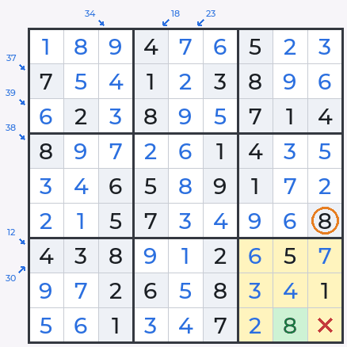

<!-- Written by tools/walkthrough.py little-killer: edit the script, not this page. -->
# Little Killer, step 48: the 8 in box 9

**Step 48 of 49** · [← Step 47](step-47.md) · [All steps](../little-killer.md#the-whole-puzzle-step-by-step) · [Step 49 →](step-49.md)

Box 9 needs an 8. r9c9: column 9 has one (r6c9). Only **r9c8** is left: **r9c8 = 8**.

**Step 48 of 49** · [← Step 47](step-47.md) · [All steps](../little-killer.md#the-whole-puzzle-step-by-step) · [Step 49 →](step-49.md)
