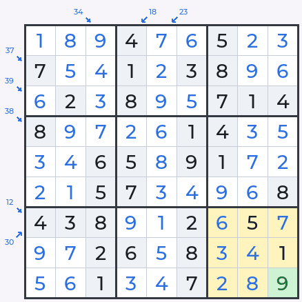

<!-- Written by tools/walkthrough.py little-killer: edit the script, not this page. -->
# Little Killer, step 49: the 9 in box 9

**Step 49 of 49** · [← Step 48](step-48.md) · [All steps](../little-killer.md#the-whole-puzzle-step-by-step) · [All steps](../little-killer.md#the-whole-puzzle-step-by-step)

Box 9 needs a 9, and r9c9 is its last empty cell: **r9c9 = 9**.

Solved.

**Step 49 of 49** · [← Step 48](step-48.md) · [All steps](../little-killer.md#the-whole-puzzle-step-by-step) · [All steps](../little-killer.md#the-whole-puzzle-step-by-step)
