# Lockout Lines

[← All variants](README.md) · [Puzzles](../features-puzzles.md) · [How to play](../how-to-play.md)

## The rules

[Classic](classic.md) rules, and **grey lines with a diamond at each end**: the two diamonds' digits are **4 or more apart**, and every digit between them on the line lies **outside their range**. With 2 and 7 in the diamonds, the cells between can only be 1, 8 or 9. A line has 3 to 6 cells.

## On the board

- The lines are thin and grey, from diamond to diamond, through the cell centres; lines don't cross each other.
- Diamonds less than 4 apart turn red, and so does a digit between them inside their range (and any 5 between).
- The grader and hints try every pair of digits the diamonds still allow: "The diamonds at this line's ends are 4 or more apart, and the digits between them lie outside that range, so row 3, column 4 can only be 1."
- **Puzzles → ⋮ → New puzzle → Lines → Lockout**: 8 lines (Hard and Expert: 10).

## How to solve it

- **Never a 5 between the diamonds:** two digits 4 or more apart always have 5 inside their range (from 1 and 5 up to 5 and 9).
- **One diamond bounds the other:** a 3 leaves 7, 8 or 9 for the other diamond; a 5 only 1 or 9.
- **The cells between push the diamonds aside:** a 3 between can't have both diamonds below it (only 1 and 2 are, and they're not 4 apart), so both are above it: one from 4 to 5, the other 8 or 9.

## Worked example

**variant-examples #46**, Lockout Lines Easy (see [Classic](classic.md#worked-example-the-whole-puzzle) for how to import the examples; cells are written r*row*c*column*).

**Step 1: r3c4.** Column 4 has 4, 5, 7 and 9; row 3 has 6 and 8; box 2 has 2: that leaves 1 and 3. r3c4 is between the diamonds of a line from the 2 in r2c5 to the 6 in r4c5, so it's below 2 or above 6: 3 is inside. **r3c4 = 1**.

**Step 2: r5c7.** Column 7 has 1, 2 and 7; row 5 has 5, 6, 8 and 9: that leaves 3 and 4. r5c7 is a diamond, and the cell next to it on its short line, r4c6, holds 3: a 3 in the diamond would have that 3 inside the range, not outside. **r5c7 = 4**.

**Step 3: r6c7.** Column 7 has 1, 2 and 7; row 6 has 4, 5 and 8; box 6 has 9: that leaves 3 and 6. r6c7 is on the line between the 5 in r5c9 and the 1 in r7c7, so it's above 5. **r6c7 = 6**.

## The whole puzzle, step by step

<!-- walkthrough -->
<!-- Written by tools/walkthrough.py lockout-lines: edit the script, not this part. -->

The whole puzzle, from the start to the last cell: 53 steps, each one a single (one place left for a digit, or one digit left for a cell), taken in the order a box's single comes first, so not quite the order of the worked example above. In each picture, the unit the step looks at is tinted yellow (for a cell with one digit left: its row, column and box), the new digit is on green, the digits that rule cells out have an **orange ring**, and the empty cells they rule out a **red cross**. Givens are on grey, digits from earlier steps in blue.

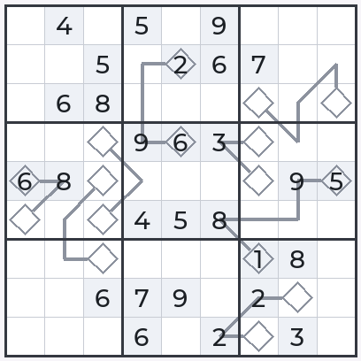

#### Step 1: the 5 in box 3

Box 3 needs a 5. r1c7, r1c8 and r1c9: row 1 has one (r1c4). r2c8 and r2c9: row 2 has one (r2c3). r3c9: column 9 has one (r5c9). r3c8: it's between the diamonds of a lockout line, and 5 is inside any two digits 4 or more apart. Only **r3c7** is left: **r3c7 = 5**.

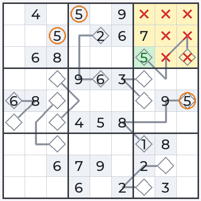

#### Step 2: the 2 in box 5

Box 5 needs a 2. r5c5: column 5 has one (r2c5). r5c6: column 6 has one (r9c6). Only **r5c4** is left: **r5c4 = 2**.

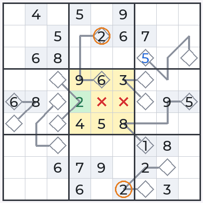

#### Step 3: the 3 in box 6

Box 6 needs a 3. r4c7, r4c8 and r4c9: row 4 has one (r4c6). r6c8: column 8 has one (r9c8). r5c7: it's a diamond, and with a 3 there its line's cells couldn't all lie outside the diamonds' range. r6c7: it's between the diamonds 1 and 5, so it's above 5. Only **r6c9** is left: **r6c9 = 3**.

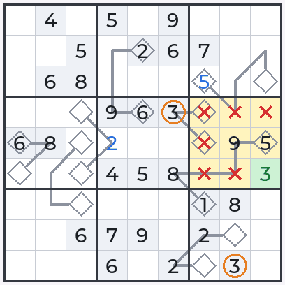

#### Step 4: the 3 in box 3

Box 3 needs a 3. r1c8, r2c8 and r3c8: column 8 has one (r9c8). r1c9, r2c9 and r3c9: column 9 has one (r6c9). Only **r1c7** is left: **r1c7 = 3**.

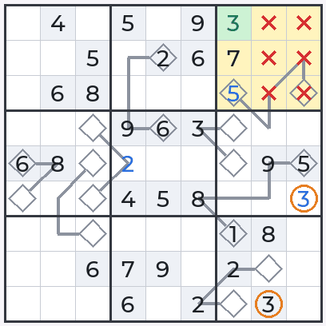

#### Step 5: the 3 in box 2

Box 2 needs a 3. r1c5: row 1 has one (r1c7). r3c6: column 6 has one (r4c6). r2c4 and r3c4: it's between the diamonds 2 and 6, so it's below 2 or above 6. Only **r3c5** is left: **r3c5 = 3**.

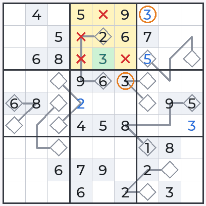

#### Step 6: the 4 in box 2

Box 2 needs a 4. r1c5: row 1 has one (r1c2). r2c4 and r3c4: column 4 has one (r6c4). Only **r3c6** is left: **r3c6 = 4**.

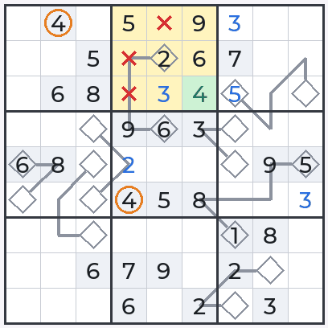

#### Step 7: the 7 in box 2

Box 2 needs a 7. r2c4: row 2 has one (r2c7). r3c4: column 4 has one (r8c4). Only **r1c5** is left: **r1c5 = 7**.

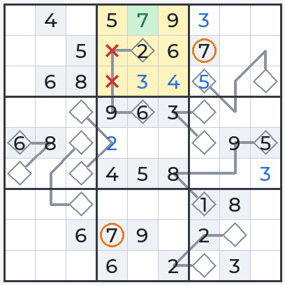

#### Step 8: the 7 in box 1

Box 1 needs a 7. r1c1 and r1c3: row 1 has one (r1c5). r2c1 and r2c2: row 2 has one (r2c7). Only **r3c1** is left: **r3c1 = 7**.

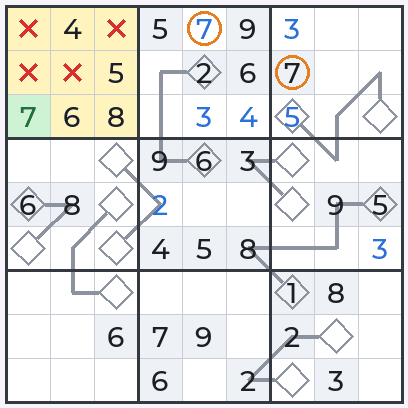

#### Step 9: the 8 in box 2

Box 2 needs an 8. r3c4: row 3 has one (r3c3). Only **r2c4** is left: **r2c4 = 8**.

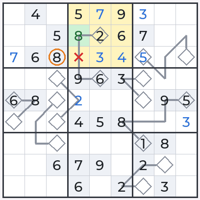

#### Step 10: the 1 in box 2

Box 2 needs a 1, and r3c4 is its last empty cell: **r3c4 = 1**.

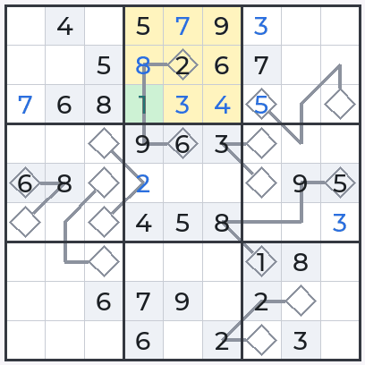

#### Step 11: the 8 in box 3

Box 3 needs an 8. r1c8: column 8 has one (r7c8). r2c8 and r2c9: row 2 has one (r2c4). r3c8 and r3c9: row 3 has one (r3c3). Only **r1c9** is left: **r1c9 = 8**.

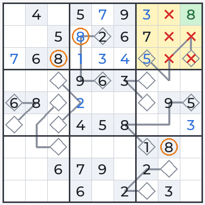

#### Step 12: the 6 in box 3

Box 3 needs a 6. r2c8 and r2c9: row 2 has one (r2c6). r3c8 and r3c9: row 3 has one (r3c2). Only **r1c8** is left: **r1c8 = 6**.

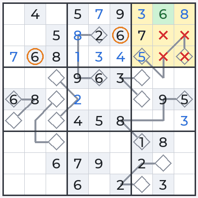

#### Step 13: the 2 in box 3

Box 3 needs a 2. r2c8 and r2c9: row 2 has one (r2c5). r3c9: it's a diamond, and a 2 is less than 4 away from the 5 in the other diamond. Only **r3c8** is left: **r3c8 = 2**.

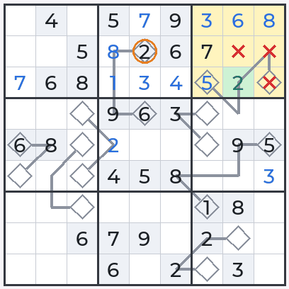

#### Step 14: the 9 in box 3

Box 3 needs a 9. r2c8: column 8 has one (r5c8). r2c9: it's between the diamonds of its line, and a 9 couldn't lie outside their range. Only **r3c9** is left: **r3c9 = 9**.

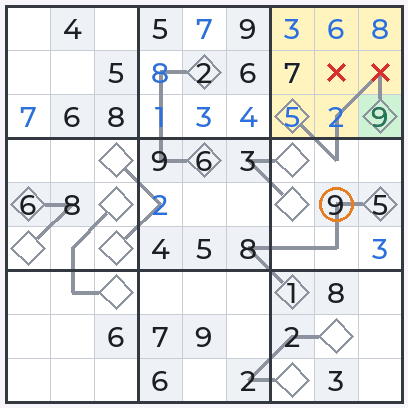

#### Step 15: the 3 in box 4

Box 4 needs a 3. r4c1, r4c2 and r4c3: row 4 has one (r4c6). r6c1, r6c2 and r6c3: row 6 has one (r6c9). Only **r5c3** is left: **r5c3 = 3**.

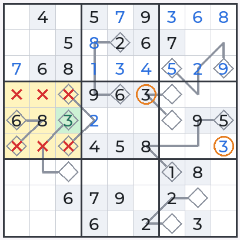

#### Step 16: the 7 in box 5

Box 5 needs a 7. r5c5: column 5 has one (r1c5). Only **r5c6** is left: **r5c6 = 7**.

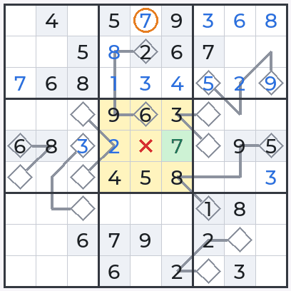

#### Step 17: the 1 in box 5

Box 5 needs a 1, and r5c5 is its last empty cell: **r5c5 = 1**.

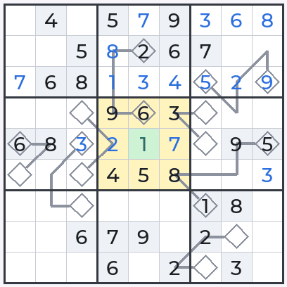

#### Step 18: the 2 in box 6

Box 6 needs a 2. r4c7 and r6c7: column 7 has one (r8c7). r4c8 and r6c8: column 8 has one (r3c8). r5c7: row 5 has one (r5c4). Only **r4c9** is left: **r4c9 = 2**.

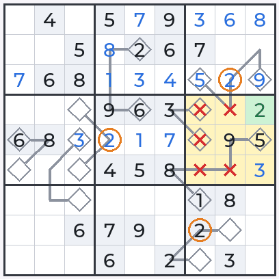

#### Step 19: the 1 in box 6

Box 6 needs a 1. r4c7 and r6c7: column 7 has one (r7c7). r5c7: row 5 has one (r5c5). r6c8: it's between the diamonds 1 and 5, so it's above 5. Only **r4c8** is left: **r4c8 = 1**.

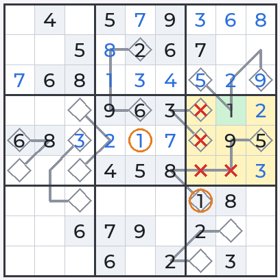

#### Step 20: the 1 in box 3

Box 3 needs a 1. r2c8: column 8 has one (r4c8). Only **r2c9** is left: **r2c9 = 1**.

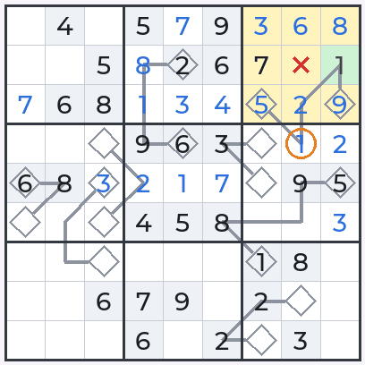

#### Step 21: the 4 in box 3

Box 3 needs a 4, and r2c8 is its last empty cell: **r2c8 = 4**.

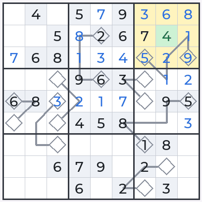

#### Step 22: the 6 in box 6

Box 6 needs a 6. r4c7: row 4 has one (r4c5). r5c7: row 5 has one (r5c1). r6c8: column 8 has one (r1c8). Only **r6c7** is left: **r6c7 = 6**.

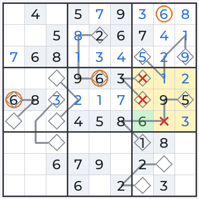

#### Step 23: the 7 in box 6

Box 6 needs a 7. r4c7: column 7 has one (r2c7). r5c7: row 5 has one (r5c6). Only **r6c8** is left: **r6c8 = 7**.

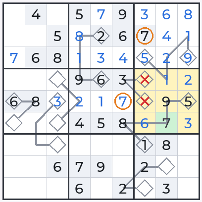

#### Step 24: the 8 in box 6

Box 6 needs an 8. r5c7: row 5 has one (r5c2). Only **r4c7** is left: **r4c7 = 8**.

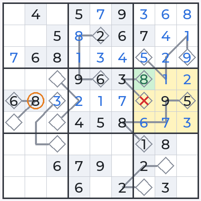

#### Step 25: the 4 in box 6

Box 6 needs a 4, and r5c7 is its last empty cell: **r5c7 = 4**.

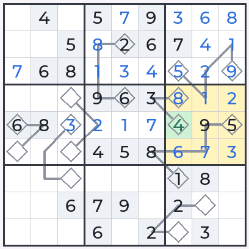

#### Step 26: the 1 in box 8

Box 8 needs a 1. r7c4, r7c5 and r7c6: row 7 has one (r7c7). r9c5: column 5 has one (r5c5). Only **r8c6** is left: **r8c6 = 1**.

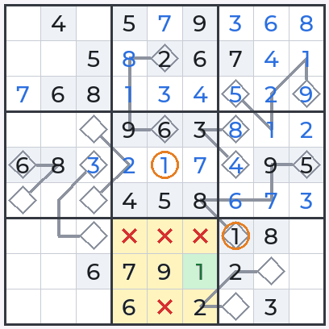

#### Step 27: the 3 in box 8

Box 8 needs a 3. r7c5: column 5 has one (r3c5). r7c6: column 6 has one (r4c6). r9c5: row 9 has one (r9c8). Only **r7c4** is left: **r7c4 = 3**.

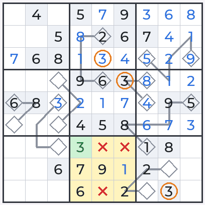

#### Step 28: the 5 in box 8

Box 8 needs a 5. r7c5 and r9c5: column 5 has one (r6c5). Only **r7c6** is left: **r7c6 = 5**.

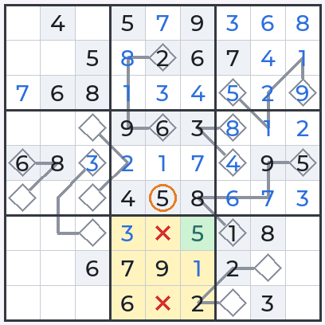

#### Step 29: the 8 in box 8

Box 8 needs an 8. r7c5: row 7 has one (r7c8). Only **r9c5** is left: **r9c5 = 8**.

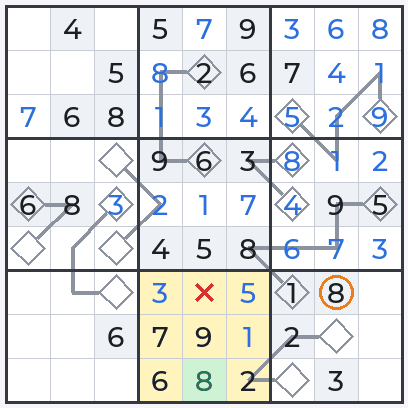

#### Step 30: the 8 in box 7

Box 7 needs an 8. r7c1, r7c2 and r7c3: row 7 has one (r7c8). r8c2: column 2 has one (r5c2). r9c1, r9c2 and r9c3: row 9 has one (r9c5). Only **r8c1** is left: **r8c1 = 8**.

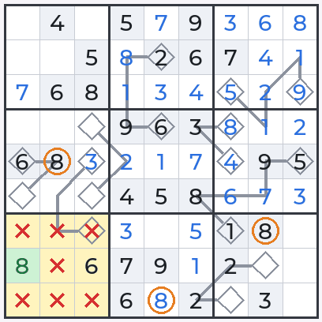

#### Step 31: the 3 in box 7

Box 7 needs a 3. r7c1, r7c2 and r7c3: row 7 has one (r7c4). r9c1, r9c2 and r9c3: row 9 has one (r9c8). Only **r8c2** is left: **r8c2 = 3**.

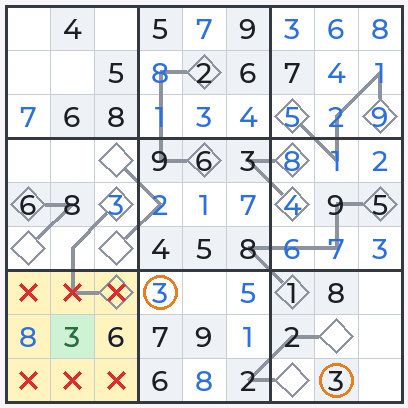

#### Step 32: the 3 in box 1

Box 1 needs a 3. r1c1 and r1c3: row 1 has one (r1c7). r2c2: column 2 has one (r8c2). Only **r2c1** is left: **r2c1 = 3**.

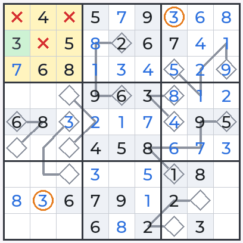

#### Step 33: the 9 in box 1

Box 1 needs a 9. r1c1 and r1c3: row 1 has one (r1c6). Only **r2c2** is left: **r2c2 = 9**.

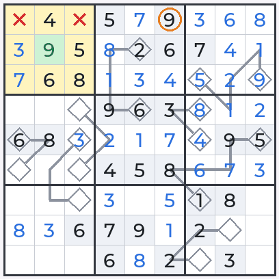

#### Step 34: the 9 in box 4

Box 4 needs a 9. r4c1, r4c2 and r4c3: row 4 has one (r4c4). r6c2: column 2 has one (r2c2). r6c1: it's a diamond, and a 9 is less than 4 away from the 6 in the other diamond. Only **r6c3** is left: **r6c3 = 9**.

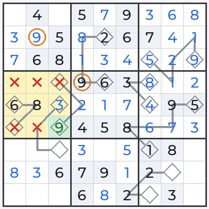

#### Step 35: the 7 in box 4

Box 4 needs a 7. r4c1: column 1 has one (r3c1). r6c1 and r6c2: row 6 has one (r6c8). r4c3: it's a diamond, and a 7 is less than 4 away from the 9 in the other diamond. Only **r4c2** is left: **r4c2 = 7**.

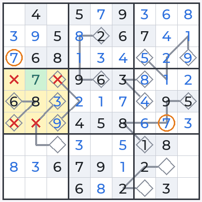

#### Step 36: the 5 in box 4

Box 4 needs a 5. r4c3: column 3 has one (r2c3). r6c1 and r6c2: row 6 has one (r6c5). Only **r4c1** is left: **r4c1 = 5**.

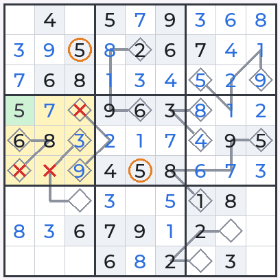

#### Step 37: the 4 in box 4

Box 4 needs a 4. r6c1 and r6c2: row 6 has one (r6c4). Only **r4c3** is left: **r4c3 = 4**.

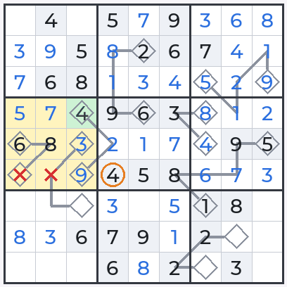

#### Step 38: the 5 in box 7

Box 7 needs a 5. r7c1, r7c2 and r7c3: row 7 has one (r7c6). r9c1: column 1 has one (r4c1). r9c3: column 3 has one (r2c3). Only **r9c2** is left: **r9c2 = 5**.

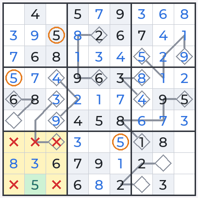

#### Step 39: the 4 in box 8

Box 8 needs a 4, and r7c5 is its last empty cell: **r7c5 = 4**.

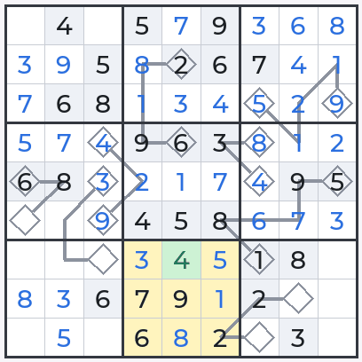

#### Step 40: the 4 in box 7

Box 7 needs a 4. r7c1, r7c2 and r7c3: row 7 has one (r7c5). r9c3: column 3 has one (r4c3). Only **r9c1** is left: **r9c1 = 4**.

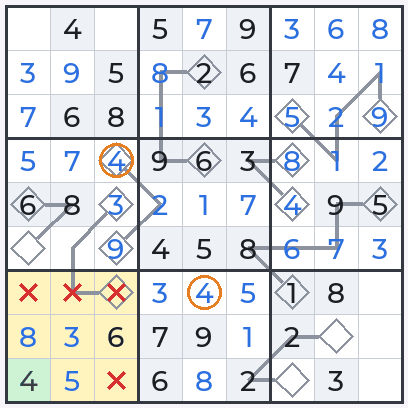

#### Step 41: the 1 in box 7

Box 7 needs a 1. r7c1, r7c2 and r7c3: row 7 has one (r7c7). Only **r9c3** is left: **r9c3 = 1**.

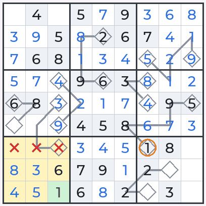

#### Step 42: the 1 in box 1

Box 1 needs a 1. r1c3: column 3 has one (r9c3). Only **r1c1** is left: **r1c1 = 1**.

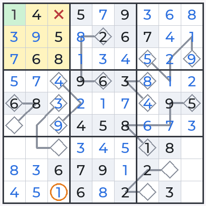

#### Step 43: the 2 in box 1

Box 1 needs a 2, and r1c3 is its last empty cell: **r1c3 = 2**.

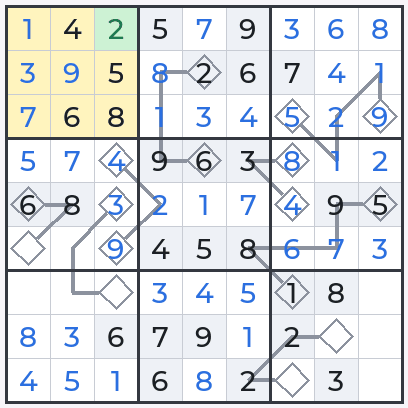

#### Step 44: the 1 in box 4

Box 4 needs a 1. r6c1: column 1 has one (r1c1). Only **r6c2** is left: **r6c2 = 1**.

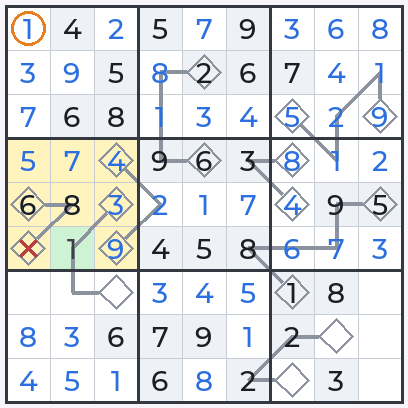

#### Step 45: the 2 in box 4

Box 4 needs a 2, and r6c1 is its last empty cell: **r6c1 = 2**.

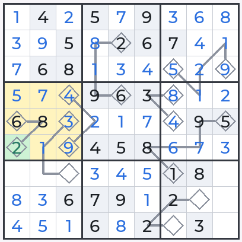

#### Step 46: the 2 in box 7

Box 7 needs a 2. r7c1: column 1 has one (r6c1). r7c3: column 3 has one (r1c3). Only **r7c2** is left: **r7c2 = 2**.

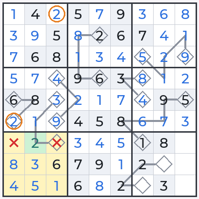

#### Step 47: the 7 in box 7

Box 7 needs a 7. r7c1: column 1 has one (r3c1). Only **r7c3** is left: **r7c3 = 7**.

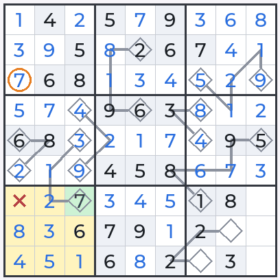

#### Step 48: the 9 in box 7

Box 7 needs a 9, and r7c1 is its last empty cell: **r7c1 = 9**.

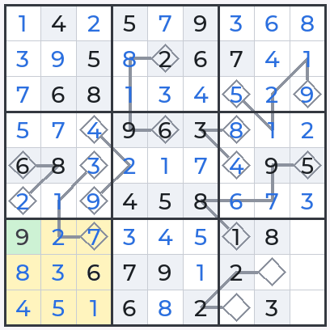

#### Step 49: the 4 in box 9

Box 9 needs a 4. r7c9: row 7 has one (r7c5). r8c8: column 8 has one (r2c8). r9c7 and r9c9: row 9 has one (r9c1). Only **r8c9** is left: **r8c9 = 4**.

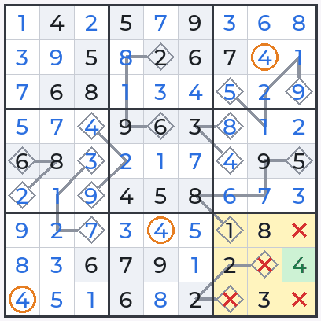

#### Step 50: the 5 in box 9

Box 9 needs a 5. r7c9: row 7 has one (r7c6). r9c7 and r9c9: row 9 has one (r9c2). Only **r8c8** is left: **r8c8 = 5**.

#### Step 51: the 6 in box 9

Box 9 needs a 6. r9c7 and r9c9: row 9 has one (r9c4). Only **r7c9** is left: **r7c9 = 6**.

#### Step 52: the 7 in box 9

Box 9 needs a 7. r9c7: column 7 has one (r2c7). Only **r9c9** is left: **r9c9 = 7**.

#### Step 53: the 9 in box 9

Box 9 needs a 9, and r9c7 is its last empty cell: **r9c7 = 9**.

Solved.

<!-- /walkthrough -->
