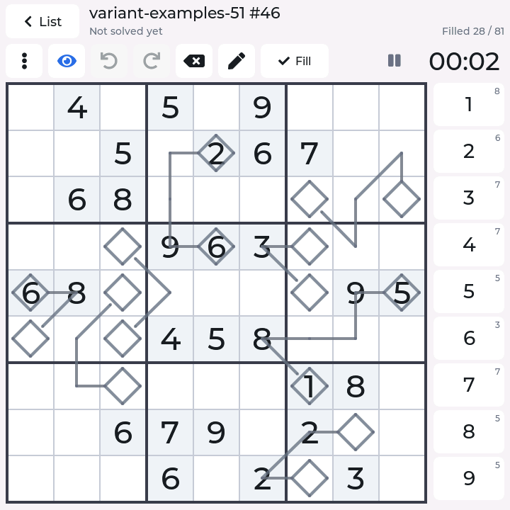

# Lockout Lines

[← All variants](README.md) · [Puzzles](../features-puzzles.md) · [How to play](../how-to-play.md)

## The rules

[Classic](classic.md) rules, and **grey lines with a diamond at each end**: the two diamonds' digits are **4 or more apart**, and every digit between them on the line lies **outside their range**. With 2 and 7 in the diamonds, the cells between can only be 1, 8 or 9. A line has 3 to 6 cells.

## On the board

- The lines are thin and grey, from diamond to diamond, through the cell centres; lines don't cross each other.
- Diamonds less than 4 apart turn red, and so does a digit between them inside their range (and any 5 between).
- The grader and hints try every pair of digits the diamonds still allow: "The diamonds at this line's ends are 4 or more apart, and the digits between them lie outside that range, so row 3, column 4 can only be 1."
- **Puzzles → ⋮ → New puzzle → Lines → Lockout**: 8 lines (Hard and Expert: 10).

## How to solve it

- **Never a 5 between the diamonds:** two digits 4 or more apart always have 5 inside their range (from 1 and 5 up to 5 and 9).
- **One diamond bounds the other:** a 3 leaves 7, 8 or 9 for the other diamond; a 5 only 1 or 9.
- **The cells between push the diamonds aside:** a 3 between can't have both diamonds below it (only 1 and 2 are, and they're not 4 apart), so both are above it: one from 4 to 5, the other 8 or 9.

## Worked example

**variant-examples #46**, Lockout Lines Easy (see [Classic](classic.md#worked-example-the-whole-puzzle) for how to import the examples; cells are written r*row*c*column*).

**Step 1: r3c4.** Column 4 has 4, 5, 7 and 9; row 3 has 6 and 8; box 2 has 2: that leaves 1 and 3. r3c4 is between the diamonds of a line from the 2 in r2c5 to the 6 in r4c5, so it's below 2 or above 6: 3 is inside. **r3c4 = 1**.

**Step 2: r5c7.** Column 7 has 1, 2 and 7; row 5 has 5, 6, 8 and 9: that leaves 3 and 4. r5c7 is a diamond, and the cell next to it on its short line, r4c6, holds 3: a 3 in the diamond would have that 3 inside the range, not outside. **r5c7 = 4**.

**Step 3: r6c7.** Column 7 has 1, 2 and 7; row 6 has 4, 5 and 8; box 6 has 9: that leaves 3 and 6. r6c7 is on the line between the 5 in r5c9 and the 1 in r7c7, so it's above 5. **r6c7 = 6**.

## The whole puzzle, step by step

<!-- walkthrough -->
<!-- Written by tools/walkthrough.py lockout-lines: edit the script, not this part. -->

The whole puzzle, from the start to the last cell: 53 steps, each one a single (one place left for a digit, or one digit left for a cell), taken in the order a box's single comes first, so not quite the order of the worked example above. Each step has a page of its own, with **Previous** and **Next**: pick one from the list below. In each picture, the unit the step looks at is tinted yellow (for a cell with one digit left: its row, column and box), the new digit is on green, the digits that rule cells out have an **orange ring**, and the empty cells they rule out a **red cross**. Givens are on grey, digits from earlier steps in blue.

1. [the 5 in box 3](lockout-lines/step-01.md)
2. [the 2 in box 5](lockout-lines/step-02.md)
3. [the 3 in box 6](lockout-lines/step-03.md)
4. [the 3 in box 3](lockout-lines/step-04.md)
5. [the 3 in box 2](lockout-lines/step-05.md)
6. [the 4 in box 2](lockout-lines/step-06.md)
7. [the 7 in box 2](lockout-lines/step-07.md)
8. [the 7 in box 1](lockout-lines/step-08.md)
9. [the 8 in box 2](lockout-lines/step-09.md)
10. [the 1 in box 2](lockout-lines/step-10.md)
11. [the 8 in box 3](lockout-lines/step-11.md)
12. [the 6 in box 3](lockout-lines/step-12.md)
13. [the 2 in box 3](lockout-lines/step-13.md)
14. [the 9 in box 3](lockout-lines/step-14.md)
15. [the 3 in box 4](lockout-lines/step-15.md)
16. [the 7 in box 5](lockout-lines/step-16.md)
17. [the 1 in box 5](lockout-lines/step-17.md)
18. [the 2 in box 6](lockout-lines/step-18.md)
19. [the 1 in box 6](lockout-lines/step-19.md)
20. [the 1 in box 3](lockout-lines/step-20.md)
21. [the 4 in box 3](lockout-lines/step-21.md)
22. [the 6 in box 6](lockout-lines/step-22.md)
23. [the 7 in box 6](lockout-lines/step-23.md)
24. [the 8 in box 6](lockout-lines/step-24.md)
25. [the 4 in box 6](lockout-lines/step-25.md)
26. [the 1 in box 8](lockout-lines/step-26.md)
27. [the 3 in box 8](lockout-lines/step-27.md)
28. [the 5 in box 8](lockout-lines/step-28.md)
29. [the 8 in box 8](lockout-lines/step-29.md)
30. [the 8 in box 7](lockout-lines/step-30.md)
31. [the 3 in box 7](lockout-lines/step-31.md)
32. [the 3 in box 1](lockout-lines/step-32.md)
33. [the 9 in box 1](lockout-lines/step-33.md)
34. [the 9 in box 4](lockout-lines/step-34.md)
35. [the 7 in box 4](lockout-lines/step-35.md)
36. [the 5 in box 4](lockout-lines/step-36.md)
37. [the 4 in box 4](lockout-lines/step-37.md)
38. [the 5 in box 7](lockout-lines/step-38.md)
39. [the 4 in box 8](lockout-lines/step-39.md)
40. [the 4 in box 7](lockout-lines/step-40.md)
41. [the 1 in box 7](lockout-lines/step-41.md)
42. [the 1 in box 1](lockout-lines/step-42.md)
43. [the 2 in box 1](lockout-lines/step-43.md)
44. [the 1 in box 4](lockout-lines/step-44.md)
45. [the 2 in box 4](lockout-lines/step-45.md)
46. [the 2 in box 7](lockout-lines/step-46.md)
47. [the 7 in box 7](lockout-lines/step-47.md)
48. [the 9 in box 7](lockout-lines/step-48.md)
49. [the 4 in box 9](lockout-lines/step-49.md)
50. [the 5 in box 9](lockout-lines/step-50.md)
51. [the 6 in box 9](lockout-lines/step-51.md)
52. [the 7 in box 9](lockout-lines/step-52.md)
53. [the 9 in box 9](lockout-lines/step-53.md)

Solved.

<!-- /walkthrough -->
