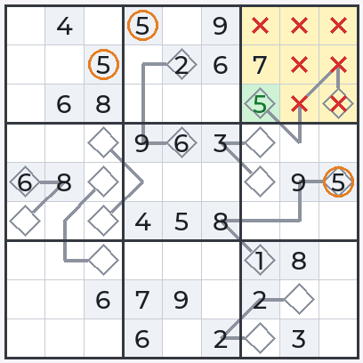

<!-- Written by tools/walkthrough.py lockout-lines: edit the script, not this page. -->
# Lockout Lines, step 1: the 5 in box 3

**Step 1 of 53** · [← The start](../lockout-lines.md#the-whole-puzzle-step-by-step) · [All steps](../lockout-lines.md#the-whole-puzzle-step-by-step) · [Step 2 →](step-02.md)

Box 3 needs a 5. r1c7, r1c8 and r1c9: row 1 has one (r1c4). r2c8 and r2c9: row 2 has one (r2c3). r3c9: column 9 has one (r5c9). r3c8: it's between the diamonds of a lockout line, and 5 is inside any two digits 4 or more apart. Only **r3c7** is left: **r3c7 = 5**.

**Step 1 of 53** · [← The start](../lockout-lines.md#the-whole-puzzle-step-by-step) · [All steps](../lockout-lines.md#the-whole-puzzle-step-by-step) · [Step 2 →](step-02.md)
