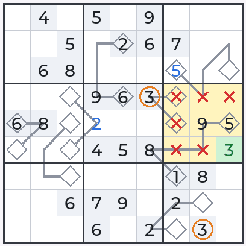

<!-- Written by tools/walkthrough.py lockout-lines: edit the script, not this page. -->
# Lockout Lines, step 3: the 3 in box 6

**Step 3 of 53** · [← Step 2](step-02.md) · [All steps](../lockout-lines.md#the-whole-puzzle-step-by-step) · [Step 4 →](step-04.md)

Box 6 needs a 3. r4c7, r4c8 and r4c9: row 4 has one (r4c6). r6c8: column 8 has one (r9c8). r5c7: it's a diamond, and with a 3 there its line's cells couldn't all lie outside the diamonds' range. r6c7: it's between the diamonds 1 and 5, so it's above 5. Only **r6c9** is left: **r6c9 = 3**.

**Step 3 of 53** · [← Step 2](step-02.md) · [All steps](../lockout-lines.md#the-whole-puzzle-step-by-step) · [Step 4 →](step-04.md)
