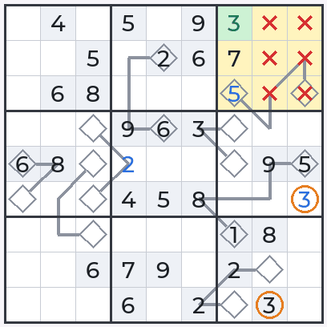

<!-- Written by tools/walkthrough.py lockout-lines: edit the script, not this page. -->
# Lockout Lines, step 4: the 3 in box 3

**Step 4 of 53** · [← Step 3](step-03.md) · [All steps](../lockout-lines.md#the-whole-puzzle-step-by-step) · [Step 5 →](step-05.md)

Box 3 needs a 3. r1c8, r2c8 and r3c8: column 8 has one (r9c8). r1c9, r2c9 and r3c9: column 9 has one (r6c9). Only **r1c7** is left: **r1c7 = 3**.

**Step 4 of 53** · [← Step 3](step-03.md) · [All steps](../lockout-lines.md#the-whole-puzzle-step-by-step) · [Step 5 →](step-05.md)
