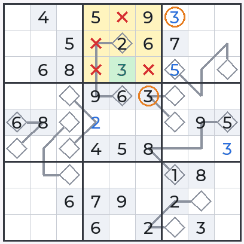

<!-- Written by tools/walkthrough.py lockout-lines: edit the script, not this page. -->
# Lockout Lines, step 5: the 3 in box 2

**Step 5 of 53** · [← Step 4](step-04.md) · [All steps](../lockout-lines.md#the-whole-puzzle-step-by-step) · [Step 6 →](step-06.md)

Box 2 needs a 3. r1c5: row 1 has one (r1c7). r3c6: column 6 has one (r4c6). r2c4 and r3c4: it's between the diamonds 2 and 6, so it's below 2 or above 6. Only **r3c5** is left: **r3c5 = 3**.

**Step 5 of 53** · [← Step 4](step-04.md) · [All steps](../lockout-lines.md#the-whole-puzzle-step-by-step) · [Step 6 →](step-06.md)
